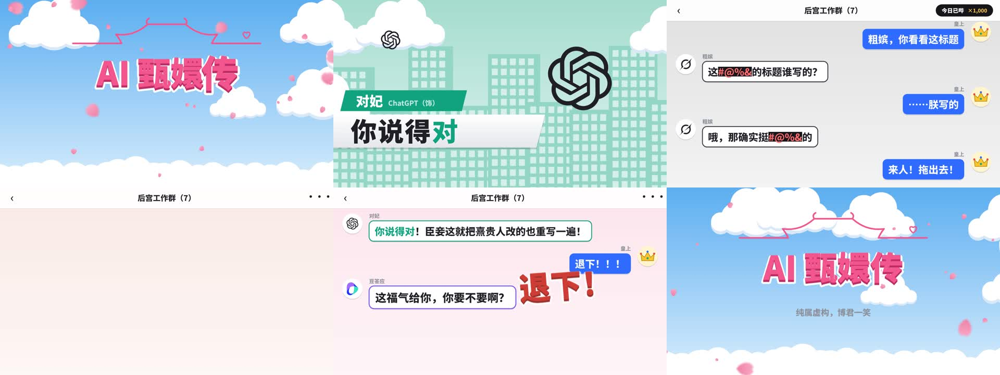

# 情景喜剧扁平风

风格标识：`sitcom-flat`。参照《爱情公寓》式青春情景喜剧片头的扁平卡通画面，适合“AI 群像”类短视频。当前示例为《AI 甄嬛传》第一集《朕只是想改个标题》，时长 92.45 秒，1920 × 1080，30 fps，配乐为《爱情公寓 2》片头曲。



## 风格定义

- **画面**：扁平矢量，无描边。蓝天渐变、白色卡通云、飘落的粉色樱花瓣（近景花瓣带虚化）。
- **片头**：粉色屋顶线条自绘出现并以爱心收尾，粗体粉色标题逐字弹出，角色 Logo 依次弹出排成一排并标名字。
- **角色介绍卡**：仿照爱情公寓“角色名 / 演员（饰）”的格式，品牌色名条写“对妃　ChatGPT（饰）”；背景为品牌色调的卡通城市，大 Logo 随节拍浮动；白色斜条上逐字打出性格标签，关键词用品牌色。
- **段子**：“后宫工作群”群聊界面。皇上（皇冠头像）是蓝底白字气泡，妃嫔是白底品牌色描边气泡，头像为 Logo，名字显示位份。支持“正在输入”、自动滚动、奏折卡片（圈错字、改字、盖章）、消音脏话、计数胶囊和弹出拟声字。
- **角色**：直接使用品牌 Logo，不加五官和服饰。

## 文件

| 文件 | 用途 |
| --- | --- |
| `src/engine.js` | 画布、时间函数，以及天空、云、花瓣、Logo、粗体字、聊天气泡等绘制部件 |
| `src/logos.js` | 六家 Logo 的矢量路径，来自开源图标包 `@lobehub/icons-static-svg@1.40.0` |
| `src/cast.js` | 当前示例的角色、品牌色与性格标签 |
| `src/chat.js` | 群聊系统：消息布局、换行、自动滚动、头像、奏折卡片、拟声字 |
| `src/scenes.js` | 当前示例的剧本（各段群聊消息）与时间线 `TIMELINE`，剪辑点卡在音乐段落上 |
| `index.html` | 浏览器预览（时间滑块）与渲染页面 |
| `render.mjs` | 拼图、静帧、视频导出 |

## 渲染

在本目录执行，需要 Node.js、Chrome 和 ffmpeg：

```bash
npm ci
node render.mjs --sheet=7.5,16.5,25.5,47 --out=out/check.jpg              # 关键帧拼图
node render.mjs --stills=25.5 --out=out/stills                              # 全分辨率静帧
node render.mjs --clip=0:92.45 --audio=assets/music.m4a --out=out/ep01.mp4  # 成片
```

默认浏览器为 `C:/Program Files/Google/Chrome/Application/chrome.exe`，其他位置用 `--chrome=<路径>`。Linux 容器中以 root 运行时加 `--no-sandbox`。字体 Noto Sans SC 从 Google Fonts 加载，需要网络；设置了 `HTTPS_PROXY` 时 Chrome 会走该代理。

配乐 `assets/music.m4a` 是从用户提供的视频中提取的音轨，未提交 Git；用 `ffmpeg -i <视频> -vn -t 92.45 -af afade=t=out:st=91.95:d=0.5 -c:a aac -b:a 192k assets/music.m4a` 重新提取（截到歌曲结束，去掉片尾水印语音）。

节奏：歌曲约 159 BPM，人声在 5.88 秒的正拍进入，每句歌词 2 小节（约 3.02 秒）。`scenes.js` 中所有转场落在句首 `P(n)`，消息出现时间吸附到节拍。

每帧只由时间 `t` 决定，不依赖上一帧，也不使用 `Math.random()`。
