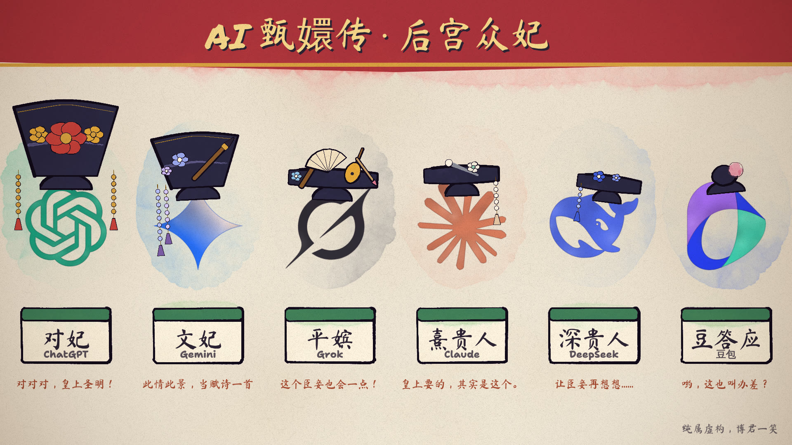

# AI 甄嬛传（水彩墨线风格作品）

本目录是 `watercolor-ink` 风格的第二个作品，复用 `../../src/core.js` 的绘画引擎。剧本与人设见仓库根目录 `creative_materials/2026-10-17_AI甄嬛传_角色设定与第一集分镜/`。

## 角色造型

每个角色 = 原品牌 Logo + 手绘清宫头饰，不加五官。头饰大小表示位份：妃（大拉翅）> 嫔、贵人（两把头）> 答应（小发髻）。



| 文件 | 用途 |
| --- | --- |
| `src/logos.js` | 六家 Logo 的矢量路径，来自开源图标包 `@lobehub/icons-static-svg@1.40.0` |
| `src/costume.js` | Logo 的水彩化绘制、头饰部件（大拉翅、两把头、花、流苏、发簪、毛笔等）和六位角色的造型配置 |
| `src/cast_sheet.js` | 六人造型图 |
| `cast_sheet.html` | 造型图页面 |

## 渲染造型图

在 `styles/watercolor-ink/` 目录执行：

```bash
node render.mjs --page=works/ai-zhenhuan/cast_sheet.html --stills=0 --out=out/zhenhuan
```

Linux 容器中以 root 运行时加 `--no-sandbox`，并用 `--chrome=<路径>` 指定浏览器。

## 待办

- 引擎画布目前固定为 1920 × 1080；竖屏成片需要让 `core.js` 支持可配置的画幅。
- 根据第一集分镜编写各镜头。
